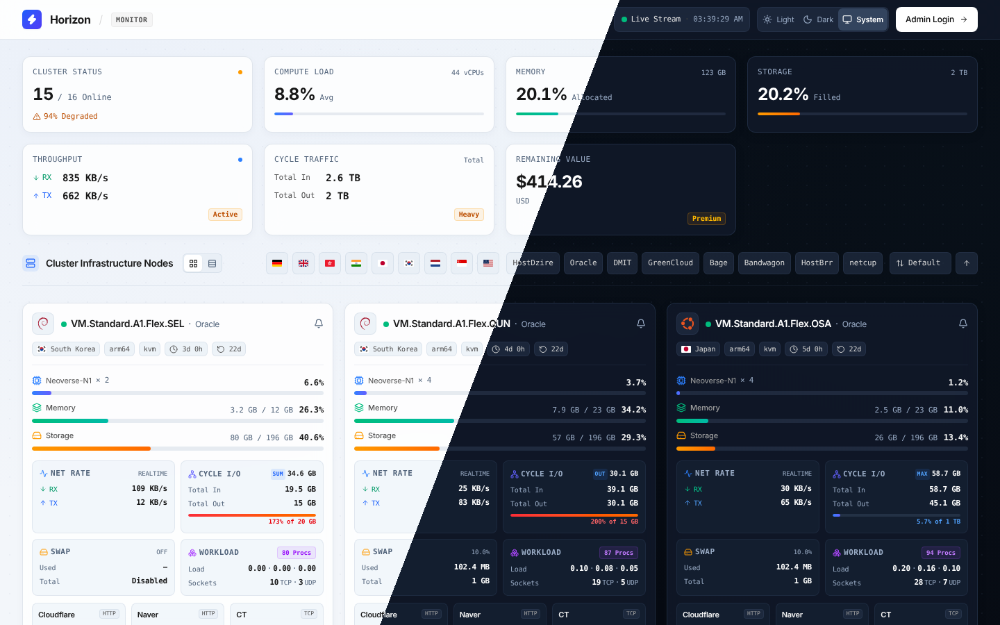
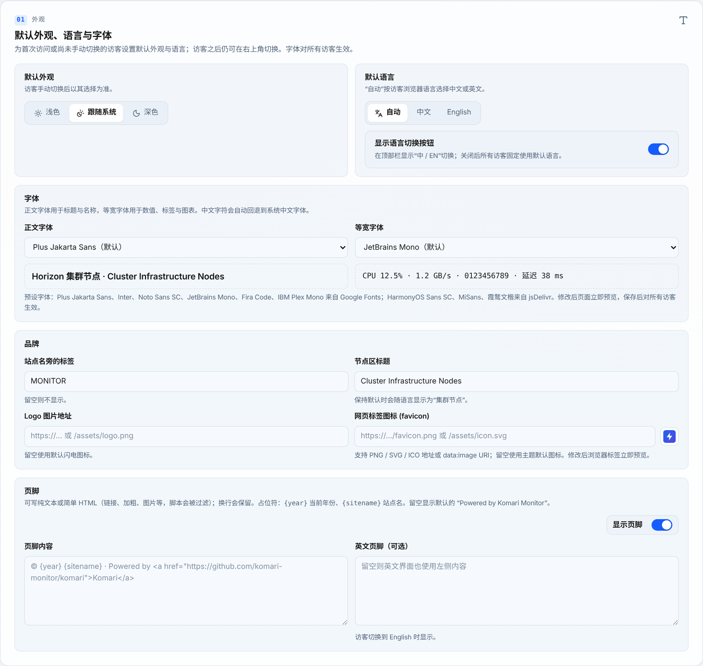
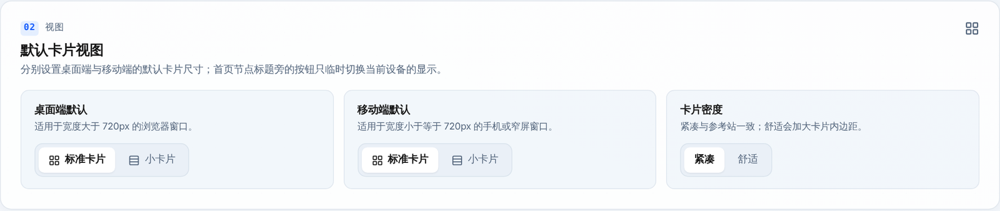
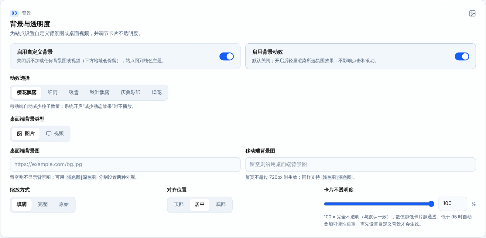
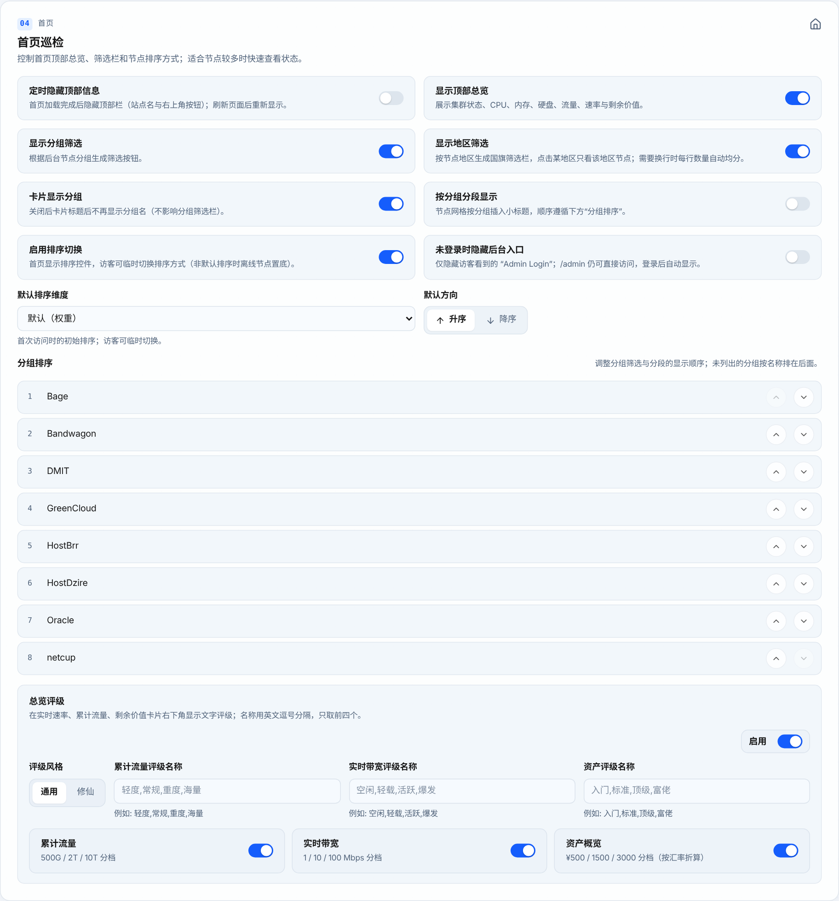
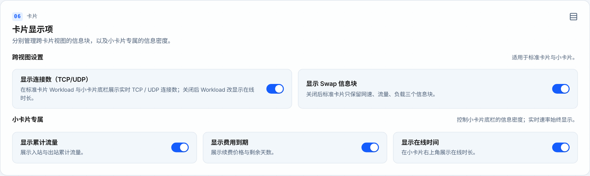
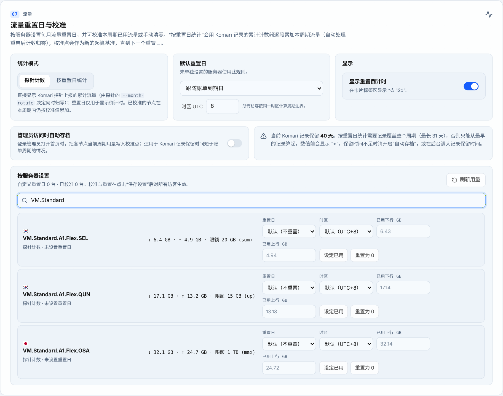
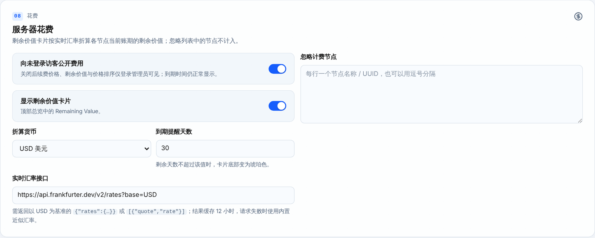
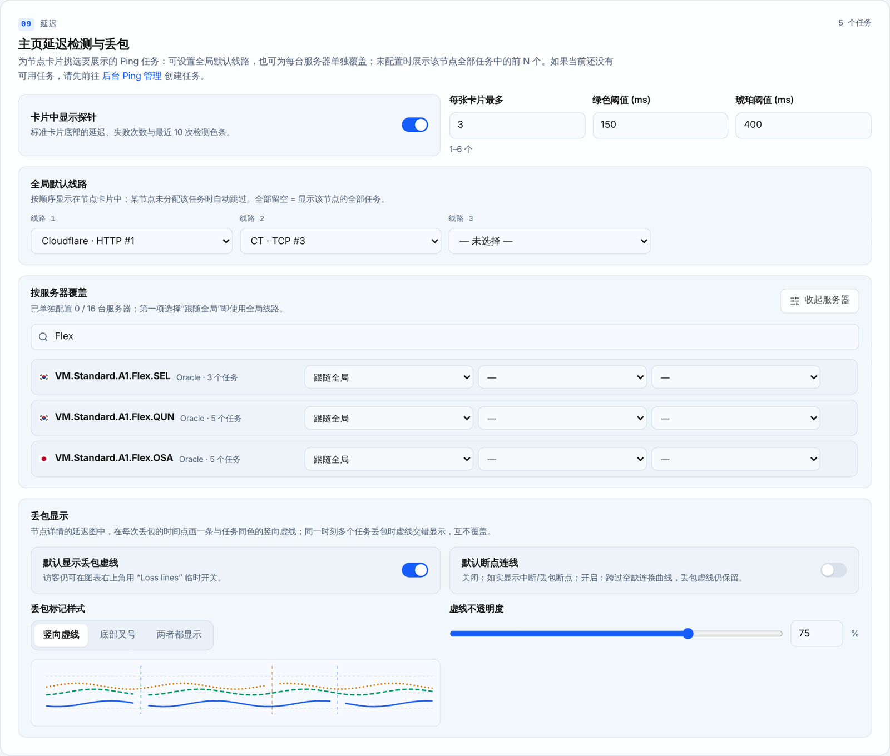
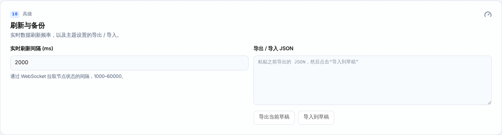

# Horizon · Komari 主题

高密度、控制台风格的 [Komari Monitor](https://github.com/komari-monitor/komari) 公开状态页主题。一屏俯瞰整个集群：总览、节点卡片、流量周期、延迟探针与历史图表。

纯 HTML / CSS / JS，无需构建。

**在线演示**：<https://demos.dowsion.com> — 15 台模拟节点，覆盖 CN / HK / JP / US / DE，按 线路机 / 落地机 / 家宽 分组；数据在浏览器内模拟，右上角齿轮可体验主题设置（只保存在本机）。

<p align="center"></p>

## 功能

- **中英双语**：首页与主题设置页均可一键切换「中 / EN」，默认按访客浏览器语言自动选择，也可在设置中固定
- **自定义字体**：正文与等宽字体分别设置；内置 Plus Jakarta Sans、Inter、Noto Sans SC、HarmonyOS Sans SC、MiSans、霞鹜文楷、JetBrains Mono、Fira Code、IBM Plex Mono 等预设，也可填写任意 CSS 样式表或字体文件
- **顶部栏**：站点名 + 标签、实时连接与时钟、浅色 / 深色 / 跟随系统、语言切换、后台入口；登录后显示主题设置齿轮
- **集群总览**：在线状态、CPU、内存、硬盘、实时速率、周期流量、剩余价值（可选文字评级：通用 / 修仙 / 自定义）
- **筛选与排序**：国旗地区筛选（需要换行时每行数量自动均分）、分组筛选、访客排序（名称、地区、CPU、内存、硬盘、速率、流量、在线时长、价格、到期）
- **节点卡片**（标准 / 小卡片两种视图）：系统图标、地区 / 架构 / 虚拟化 / 在线时长 / 重置倒计时、CPU · 内存 · 硬盘、**网速 + 周期流量合一信息块**（上行 / 下行实时速率大字显示，点阵展示最近速率变化，下方为出站 / 入站周期用量，按计费方式显示已用量 + 用量条）、通栏的负载与连接数、延迟探针（最新延迟 + 最近 1 小时丢包率 + 20 格色条，每格为 3 分钟平均延迟）、标签与账单；小卡片同样显示各线路延迟与丢包率，实时速率与周期流量分两行
- **节点详情**：CPU / 内存 / 网络（RX/TX 镜像）/ 负载 / 硬盘历史图（1h · 8h · 24h · 7d · 30d），延迟探针图（**延迟 / 丢包率**两种视图，任务标签显示最新延迟与区间丢包率，**削峰平滑**、断点连线、**丢包虚线**开关），心跳日志
- **流量周期**：按重置日统计（自动处理重启计数归零）、按服务器自定义重置日与时区、**流量校准**（设定已用 / 重置为 0）、可选管理员自动存档
- **背景与动效**：自定义背景图（区分浅色/深色、移动端）、桌面视频背景、卡片不透明度、樱花 / 细雨 / 缓雪 / 秋叶 / 彩纸 / 烟花
- **移动端**：卡片信息块按自身宽度自适应；实时刷新只更新变化的数据，不会触发 iOS Safari 自动滚动

## 安装

1. 到 [Releases](https://github.com/Dowsion-dev/Komari-Theme-Horizon/releases/latest) 下载 `Komari-Theme-Horizon-vX.Y.Z.zip`
2. Komari 后台 → **设置 → 主题** → 上传 zip → 选中 **Horizon**
3. 登录后打开首页，点击右上角 **⚙ 齿轮** 进入主题设置（也可直接访问 `/?view=theme-manage`）

> 站点在 Cloudflare 等 CDN 后面也没关系：资源地址带版本号（如 `app.css?v=1.4.0`），升级后会自动拿到新文件。

## 主题设置

设置页仅登录管理员可见（与首页一样支持中英文切换），修改后点底部 **保存设置**，保存到 Komari 的 `theme_settings`，对所有访客立即生效。页面顶部有分区导航，底部固定栏提供 **返回首页 / 恢复默认 / 重置 / 保存设置**。

### 01 外观 — 默认外观、语言与字体



- **默认外观**：浅色 / 跟随系统 / 深色，作用于首次访问或尚未手动切换的访客
- **默认语言**：自动（按浏览器语言）/ 中文 / English；可关闭顶部栏的「中 / EN」切换按钮，让所有访客固定使用默认语言
- **字体**：正文字体（标题、名称）与等宽字体（数值、标签、图表）分别选择预设或「自定义」——填写 CSS 样式表地址（Google Fonts、jsDelivr 等）或直接填写 woff2 / woff / ttf / otf 字体文件，并填写 font-family 名称；修改后立即预览，下次打开页面时首屏即使用所选字体
- **品牌**：站点名旁的标签（默认 `MONITOR`，留空不显示）、节点区标题（保持默认时随语言显示为「集群节点」）、Logo 图片地址（留空使用闪电图标）、**网页标签图标**（favicon，支持 PNG / SVG / ICO 地址或 data:image，修改后立即预览）
- **页脚**：可开关；内容可写纯文本或简单 HTML（链接、加粗、图片，脚本与事件属性会被过滤），换行保留，支持 `{year}`、`{sitename}` 占位符；可另填英文页脚，访客切换到 English 时显示

### 02 视图 — 默认卡片视图



- 分别设置 **桌面端**（宽度 > 720px）与 **移动端** 的默认视图：标准卡片 / 小卡片；首页节点标题旁的按钮可让访客临时切换
- **卡片密度**：紧凑（默认）或舒适

### 03 背景 — 背景与透明度



- **启用自定义背景**：关闭后保留地址但不加载
- **背景动效**：樱花飘落 / 细雨 / 缓雪 / 秋叶飘落 / 庆典彩纸 / 烟花，不影响点击和滚动，移动端自动减少粒子
- **背景图**：桌面端与移动端分别设置，均支持 `浅色图|深色图`；**桌面视频**可分浅色 / 深色（仅宽屏、非触摸、未开启省流量时加载）
- **缩放方式**（填满 / 完整 / 原始）、**对齐位置**（顶部 / 居中 / 底部）、**卡片不透明度**（低于 95 时自动加可读性遮罩）

### 04 首页 — 首页巡检



- **定时隐藏顶部信息**：加载后 N 秒（1–3600）隐藏顶部栏
- 显示开关：顶部总览、分组筛选、地区筛选、卡片显示分组、按分组分段显示
- **排序**：是否允许访客切换排序、默认排序维度与方向（非默认排序时离线节点置底）
- **未登录时隐藏后台入口**
- **分组排序**：上移 / 下移调整分组筛选与分段的顺序
- **总览评级**：在实时速率、累计流量、剩余价值卡片显示文字评级；风格可选 通用 / 修仙，也可自定义四档名称

### 05 隐藏 — 隐藏节点


- 每行一个节点名称或 UUID（大小写不敏感）；被隐藏的节点不显示卡片，也不计入在线数、流量、速率与资产等统计

### 06 卡片 — 卡片显示项



- **标准卡片**：显示 TCP / UDP 连接数（关闭后 Workload 改显示在线时长）
- **小卡片专属**：显示累计流量、费用到期、在线时间

### 07 流量 — 流量重置日与校准



- **统计模式**：
  - *探针计数*：显示 Komari 探针上报的累计流量（由探针 `--month-rotate` 决定何时归零），重置日只用于倒计时
  - *按重置日统计*：每到重置日自动开始新周期；用量由 Komari 记录中的累计计数器逐段累加，重启后计数归零也能接续
- **默认重置日**（跟随账单到期日 / 每月固定某日 / 不重置）与 **时区**（所有访客按同一时区计算周期）、是否显示 **重置倒计时**
- **管理员访问时自动存档**：记录保留时间短于账单周期时，管理员打开首页会定期把当前用量存为校准点
- **按服务器设置**：每台服务器单独指定重置日与**重置时区**（如美国家宽按美国当地时间零点重置），查看本周期用量与下次重置日期；**设定已用**（填写已用下行 / 上行 GB）、**重置为 0**、清除校准
- Komari 默认只保留 1 天记录；保留时间不足时数值前显示「≈」，页面会给出提示

### 08 花费 — 服务器花费



- **向未登录访客公开费用**：关闭后价格、剩余价值与价格排序仅管理员可见（到期时间仍显示）
- **显示剩余价值卡片**、**折算货币**、**到期提醒天数**（剩余天数不超过该值时卡片底部变琥珀色）
- **实时汇率接口**：默认 frankfurter，结果缓存 12 小时，失败时使用内置近似汇率
- **忽略计费节点**：不计入剩余价值

### 09 延迟 — 主页延迟检测与丢包



- **卡片中显示探针**、每张卡片最多显示数量（1–6）、绿色 / 琥珀色延迟阈值
- **全局默认线路**：按顺序挑选要显示在卡片中的 Ping 任务（全部留空 = 显示该节点的全部任务）
- **按服务器覆盖**：为单台服务器单独指定探测点
- **丢包显示**：默认显示丢包虚线、默认断点连线、默认削峰平滑（5 点滑动中位数）、标记样式（竖向虚线 / 底部叉号 / 两者）、虚线不透明度，附实时预览。延迟图中每次丢包画一条与任务同色的竖向虚线，同一时刻多任务丢包时交错显示

### 10 高级 — 刷新与备份



- **实时刷新间隔**（1000–60000 ms）
- **导出 / 导入 JSON**：备份或迁移全部主题设置，导入后需点击保存

## 开发

```bash
ADMIN=1 node tools/mock.js "$PWD/dist" 8787   # 模拟 Komari API + WebSocket（ADMIN=1 = 已登录）
# 浏览器打开 http://localhost:8787 ；设置页 http://localhost:8787/?view=theme-manage

python3 tools/build-demo.py _site                 # 生成静态演示站（dist + demo/demo.js 浏览器内模拟后端）
```

推送到 main 后，`Demo site` 工作流会自动重建 `gh-pages` 分支上的演示站。

## 致谢

- 布局参考 [https://gut.qzz.io](https://gut.qzz.io/)
- 主题设置页参考 [Komari-Theme-LuminaPlus](https://github.com/shanyang242/Komari-Theme-LuminaPlus)
- 图标、国旗与字体见 [THIRD_PARTY_NOTICES.md](THIRD_PARTY_NOTICES.md)

## 许可

[MIT](LICENSE)
